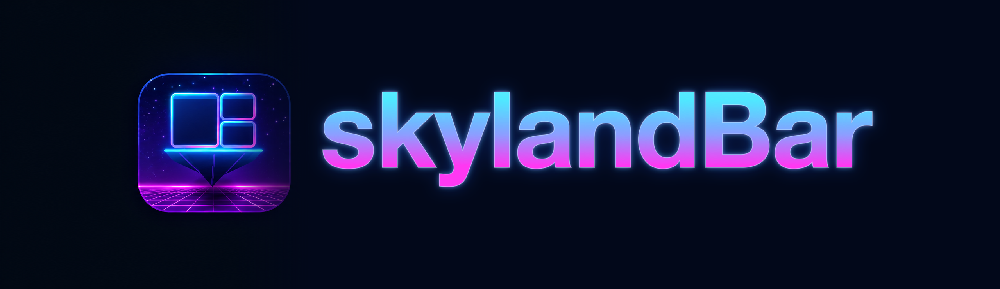
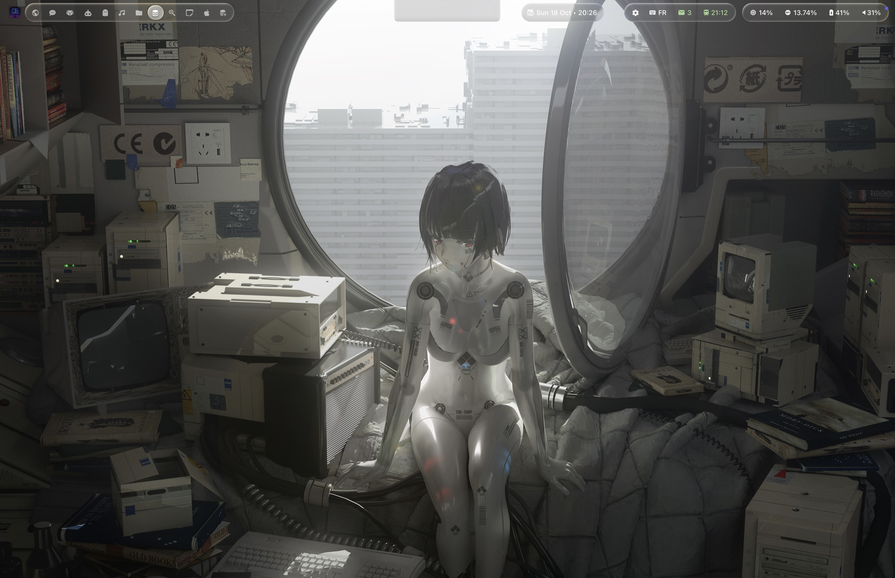
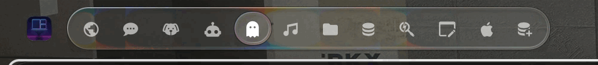
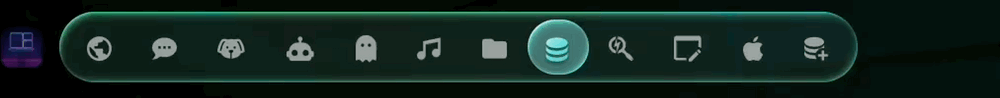
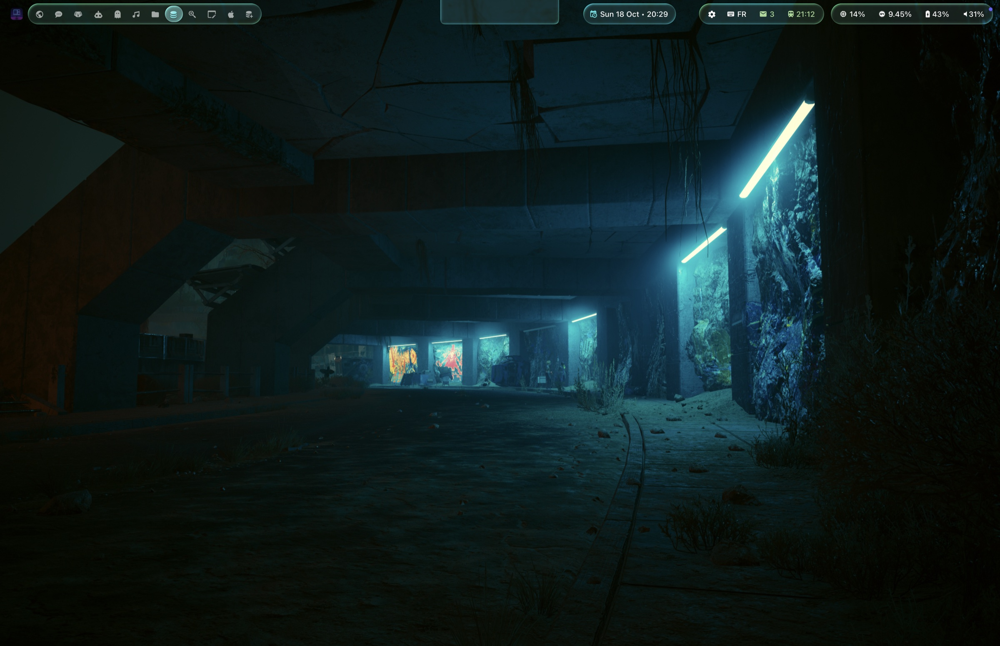
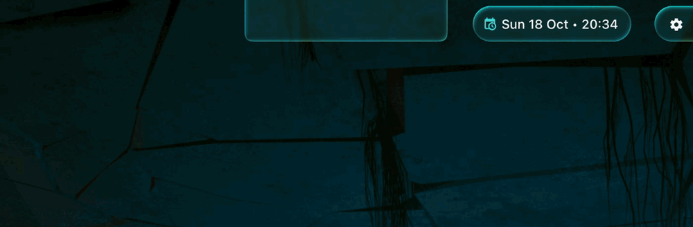
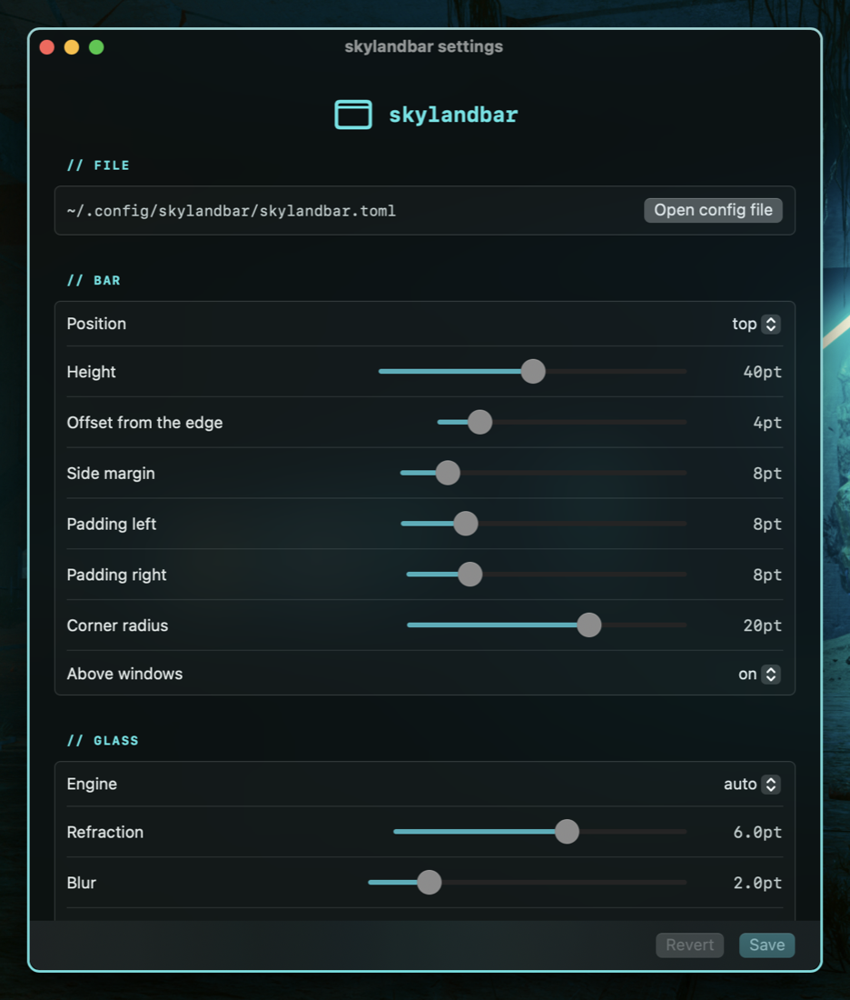
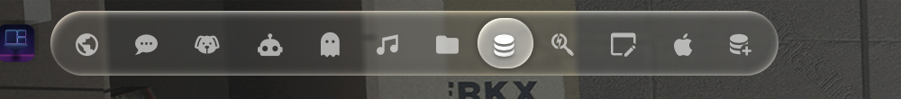
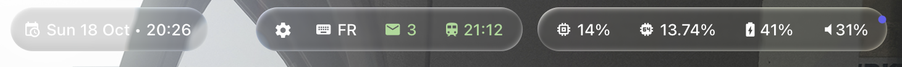

<p align="center">
  
</p>

A status bar for macOS 14 to 26 in **Liquid Glass**, written in Swift: the bar of
[skyland](https://github.com/waxdred/skyland), and a drop-in for
[SketchyBar](https://github.com/FelixKratz/SketchyBar) configs.



skylandBar draws refractive glass on every macOS it runs on (its own Metal shader where Apple's
`NSGlassEffectView` does not exist yet), knows skyland's workspaces without a single script, and
reads the TOML or `sketchybarrc` you already have:

- **Liquid Glass before macOS 26**: a shader over what is behind the bar bends it at the edges as a
  lens would, splits its colors a little, blurs and lights it; shapes close to each other melt
  together. Apple's own glass on macOS 26, a Core Animation blur where Screen Recording is not allowed
- **a selection lens** on the focused workspace that flows to the next one like a drop, stretching
  on its way and settling with a little jelly; **hover drops** under the mouse; what is under a
  drop is magnified and lit through it
- **follows the trackpad**: with skyland's workspace swipe, the lens moves with your fingers and
  springs back if you let go halfway
- **skyland and AeroSpace built in**: workspaces (with the icons of their apps), the focused window
  title, mode, focus and window events straight from the window manager's socket; skylandBar tells
  skyland its height, so tiled windows stay below it
- **the notch, boringNotch style**: hover the camera notch and a glass panel grows out of it on a
  spring, with your own items (now playing, clock, volume slider, a settings gear)
- **themes that follow skyland**: the accent comes from skyland's theme (and from the wallpaper when
  skyland picks its colors from it), light and dark variants reload with the system appearance
- **one TOML file**, hot reloaded, with vars, includes and themes, or `skylandbar --add/--set ...`
  commands from any shell or script, as SketchyBar does; a **settings window** for the bar, its glass
  and the notch, which writes back to the file with its comments kept
- **SketchyBar compatible**: scripts reach it as `sketchybar`, it holds SketchyBar's Mach names, and
  [SbarLua](https://github.com/FelixKratz/SbarLua) configs run as they are

<table>
<tr>
<td width="50%"></td>
<td width="50%"></td>
</tr>
<tr>
<td align="center">The lens flows to the focused workspace</td>
<td align="center">It follows skyland's three-finger swipe</td>
</tr>
</table>

<table>
<tr>
<td width="50%"></td>
<td width="50%"></td>
</tr>
<tr>
<td align="center">Light wallpaper</td>
<td align="center">Dark theme, its accent from the wallpaper</td>
</tr>
<tr>
<td width="50%"></td>
<td width="50%"></td>
</tr>
<tr>
<td align="center">The notch opens on a spring</td>
<td align="center"><code>skylandbar --settings</code></td>
</tr>
</table>




## Install

With [Homebrew](https://github.com/waxdred/homebrew-tap):

```sh
brew install waxdred/tap/skylandbar
mkdir -p ~/.config/skylandbar/themes
cp "$(brew --prefix)"/share/skylandbar/themes/liquid-glass.toml ~/.config/skylandbar/themes/
cp "$(brew --prefix)"/share/skylandbar/examples/liquid-glass.toml ~/.config/skylandbar/skylandbar.toml
skylandbar --check            # "ok, N items"
skylandbar --service install  # starts now and at every login
```

From source:

```sh
git clone https://github.com/waxdred/skylandBar && cd skylandBar
swift build -c release
mkdir -p ~/.config/skylandbar/themes
cp themes/liquid-glass.toml ~/.config/skylandbar/themes/
cp examples/liquid-glass.toml ~/.config/skylandbar/skylandbar.toml
.build/release/skylandbar --check            # "ok, N items"
.build/release/skylandbar --service install  # starts now and at every login
```

For the refractive glass, allow skylandbar in System Settings > Privacy & Security > Screen
Recording, then restart it. With skyland, there is nothing to set up: skyland starts the bar
when it starts. More in [docs/install.md](docs/install.md).

## Configure

`~/.config/skylandbar/skylandbar.toml`, reloaded when you save it:

```toml
hotload = true
include = "themes/liquid-glass.toml"     # glass capsules, the lens, the theme's vars

[bar]
height = 40
corner_radius = 20

[[item]]
type = "workspaces"                      # skyland's workspaces, no script
name = "ws"
position = "left"
focused = { background.glass = "lens" }  # the selection lens

[[item]]
name = "clock"
position = "right"
update_freq = 30
script = 'skylandbar --set "$NAME" label="$(date +%H:%M)"'
```

Or from a shell, a script, or a `sketchybarrc`:

```sh
skylandbar --set clock label="$(date '+%H:%M')"
skylandbar --query bar
skylandbar --export > ~/.config/skylandbar/skylandbar.toml   # a script config as TOML
```

## Documentation

| Page | For |
| --- | --- |
| [install.md](docs/install.md) | Build, first run, start at login, permissions, uninstall |
| [configuration.md](docs/configuration.md) | The TOML file: sections, items, vars, themes, includes, the settings window |
| [reference.md](docs/reference.md) | Every command, property, event and script variable |
| [components.md](docs/components.md) | Workspaces, window title, notch, brackets, graphs, sliders, aliases, popups |
| [liquid-glass.md](docs/liquid-glass.md) | The Liquid Glass theme, the three glass engines, lenses and drops |
| [skyland.md](docs/skyland.md) | skyland and AeroSpace: events, workspaces, bar height, theme colors |
| [migrating-from-sketchybar.md](docs/migrating-from-sketchybar.md) | A `sketchybarrc` and its plugins as a skylandbar config |
| [recipes.md](docs/recipes.md) | Clock, battery, volume, CPU, memory, Wi-Fi, keyboard layout, media |
| [troubleshooting.md](docs/troubleshooting.md) | Symptoms, causes, fixes |
| [ai-setup.md](docs/ai-setup.md) | For an AI assistant setting skylandbar up for you |

## Build from source

```sh
swift build -c release   # or scripts/build: the same, signed with skyland-codesign when it exists
swift test
```

```
Sources/SkylandBarCore   Foundation only and tested: values, properties, command parser, layout, model
Sources/skylandbar       AppKit: windows, drawing, Liquid Glass, socket server and client, events, scripts
Tests                    XCTest for the core
manual-tests             one script per area, with what to check
```

## License

[MIT](LICENSE)
